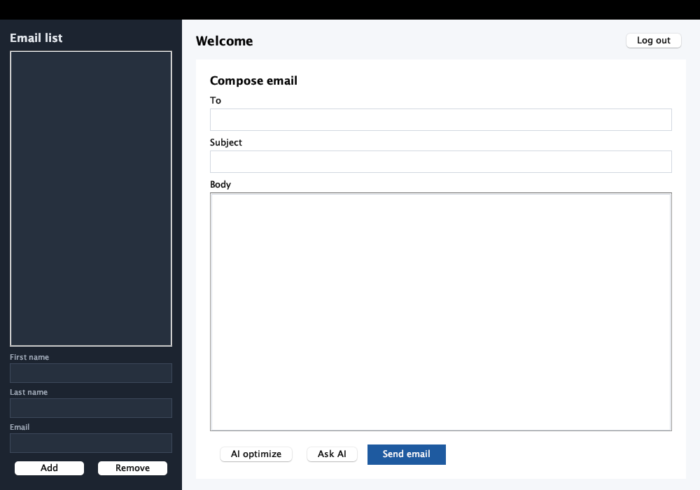
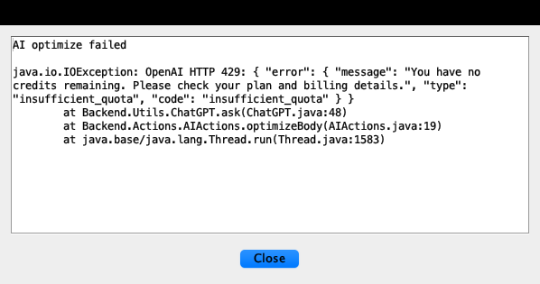

# Email Automation

Desktop app for registering an account, keeping contacts, drafting a message with the OpenAI API, and sending it over SMTP.

Run every command below from the project root (the directory that contains `pom.xml`).

## What you need

- JDK 17 or newer. Check with `java -version`.
- Docker Desktop, unless you already run MySQL yourself.

## Set the environment variables

The app reads the process environment with `System.getenv`. It does not open a `.env` file. Create `.env` yourself in the project root, using the names in `.env.example`, and fill in your own values. `.env` is listed in `.gitignore`, so those secrets are not committed.

```
DB_NAME="users"
DB_USER="emailapp"
DB_PASSWORD="choose-a-password"
DB_ROOT_PASSWORD="choose-a-root-password"
DB_HOST="localhost"
DB_PORT="3306"
OPENAI_API_KEY="sk-..."
SMTP_FROM="you@example.com"
SMTP_PASSWORD="your-mailbox-password"
SMTP_HOST="smtp.gmail.com"
```

Compose reads this file on its own when it starts MySQL. The app does not. In the same terminal you will use to start the app, load the file into the environment:

```bash
set -a
source .env
set +a
```

`set -a` exports every assignment `source` reads, which is what `System.getenv` sees. A variable loaded in another terminal, or after the app is already open, is invisible to this process. If you start the app from an IDE, put the same names on that run configuration. The IDE does not load `.env` on its own.

| Name | Purpose |
| --- | --- |
| `DB_NAME` | Database Compose creates and the app opens. The app defaults to `users` when this is unset |
| `DB_USER` | MySQL user the app signs in as |
| `DB_PASSWORD` | Password for that user |
| `DB_ROOT_PASSWORD` | Password for the MySQL root account. Compose uses it to initialize the server. The app does not sign in as root |
| `DB_HOST` | Hostname. The app defaults to `localhost` when this is unset |
| `DB_PORT` | Host port published by Compose, and the port the app dials. Defaults to `3306` |
| `OPENAI_API_KEY` | Bearer token for `https://api.openai.com/v1/chat/completions` when a message is drafted |
| `SMTP_FROM` | Mailbox address used to sign in and send |
| `SMTP_PASSWORD` | Password for that mailbox |
| `SMTP_HOST` | SMTP hostname. The app uses port 587 with STARTTLS |

`DB_USER` and `DB_PASSWORD` are read when the app opens MySQL. A missing one stops table setup with `Set <NAME> in the environment.` The OpenAI and SMTP variables are read when a message is drafted or sent, with the same kind of message.

## Start MySQL

Docker Desktop has to be open. From the project root, with `.env` already filled in:

```bash
docker compose up -d
```

Compose creates the database named by `DB_NAME` and the user named by `DB_USER` the first time the `mysql-data` volume is empty. On startup the app creates the `user` and `contacts` tables from `src/main/resources/schema/user.sql` and `src/main/resources/schema/contacts.sql`. Account passwords and email codes are stored as salted hashes.

`docker compose down` stops the container and leaves the volume in place. `docker compose down -v` deletes the volume, including every account and contact.

If MySQL is already running on the machine, create that database and user yourself and skip Compose.

A container left over from the earlier root account with an empty password does not use this volume. Delete that container, then run `docker compose up -d` again.

## Compile and run

`pom.xml` pins the libraries. The Maven Wrapper downloads Maven, then those libraries, into your local cache (`~/.m2`). Class files go in `target/`, which is gitignored.

With the environment loaded in this terminal:

```bash
./mvnw compile exec:java
```

On Windows: `mvnw.cmd compile exec:java`

That builds `src/main/java` and starts `email.automation.Main`. Creating an account emails a six-digit code. Log in with the new password and enter that code to open the mailbox. The libraries are:

- MySQL Connector/J 9.1.0
- Protocol Buffers, which that driver requires
- Gson 2.11.0
- JavaMail 1.6.2
- JavaBeans Activation Framework 1.1.1, which JavaMail needs on JDK 17 and later

## Screen



Failed actions open in a dialog.


